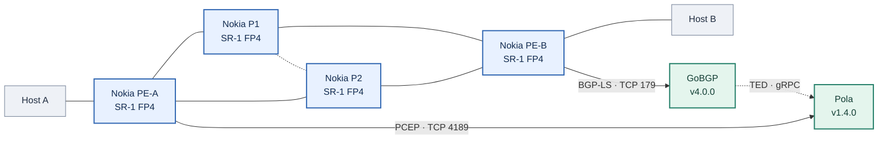

# Pola × Nokia SR OS interoperability lab

A reproducible Containerlab test of PCEP, BGP-LS, and Segment Routing with **Pola v1.4.0** and **Nokia SR-SIM 26.10.R1** on the **7750 SR-1 FP4** profile. The lab runs SR-MPLS, SRv6 full SIDs, and SRv6 uSIDs in the same topology.

[Run the lab](lab/README.md) · [Test results and packet captures](evidence/README.md) · [Containerlab topology](lab/pola-sr1.clab.yml)

## Results at a glance

| Test | Observed result |
| --- | --- |
| **PCEP and BGP-LS** | IPv4 PCEP established and resynchronized with stock Pola. BGP-LS populated Pola's TED with four routers and ten directed links. The TED tracked link removal and restoration. |
| **SR-MPLS path computation** | Pola computed IGP, TE, and hop-count paths for IPv4 and IPv6. An explicit waypoint selected P2. Losing the P1–PE-B link moved the IGP path to P2. |
| **Nokia data plane** | Host traffic passed over SR-MPLS, SRv6 full SIDs, and SRv6 uSIDs. The captures show traffic moving from P1 to P2 after local policies were enabled. |
| **SR Policy interoperability** | Stock Pola retained zero SR policies. With the [TLV 71 experiment](lab/pola-tlv71-probe.patch), Pola learned four Nokia policies. After sync, re-enabling the delegated MPLS policy elicited a PCUpd and Nokia confirmed the new path as active. |

## Topology

The router links, including P1–P2, carry IS-IS and user traffic. PE-A is the PCEP client. PE-B exports BGP-LS to GoBGP, and Pola reads GoBGP's topology over gRPC.

| VLAN | Forwarding | PE-A policy color |
| --- | --- | --- |
| 300 | SR-MPLS VPN | 101 |
| 400 | SRv6 VPN with full SIDs | 201 |
| 500 | SRv6 VPN with uSIDs | 301 |

## What the capture proves

Both peers advertise SR Policy Association Type 6. In stock Pola v1.4.0, the Pola OPEN lacks the SRPOLICY-CAPABILITY TLV. The experimental build adds that single TLV with zero flags. The following exchange then appears on the wire. [RFC 9862 §5.1](https://www.rfc-editor.org/rfc/rfc9862.html#section-5.1)

| Frame | Direction | Message and result |
| ---: | --- | --- |
| 11, 13 | Nokia ↔ Pola | Each OPEN carries TLV 71 |
| 18 | Nokia → Pola | PCRpt synchronizes the four explicit policies |
| 22 | Nokia → Pola | PCRpt delegates dynamic color 103 after synchronization |
| 24 | Pola → Nokia | PCUpd sends labels `16002 → 16004` |
| 26 | Nokia → Pola | PCRpt confirms color 103 is active with those labels |

[Stock capture](evidence/pcep-ipv4-open.pcap) · [Experimental capture](evidence/pcep-capability-probe.pcap) · [Pola policy output](evidence/pola-experiment-policies.log)

## Scope

Results are from SR-SIM on 24 November 2026. The [test matrix](evidence/README.md) records the IPv6 PCEP source-address rejection, the missing SRv6 Node SID for CSPF, the missing delay metric in Pola's TED, and the initial-sync behavior of the delegated policy. The experimental patch isolates capability negotiation for this test.
